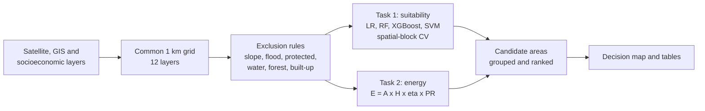

# SolarSiteAi

**An intelligent remote-sensing framework for solar farm site suitability and energy potential assessment using satellite data.**

Minor project, Department of Computer Science and Engineering, Indian Institute of Information Technology Ranchi.
Study area: **Jharkhand, India**.

| | |
|---|---|
| Authors | Ayush Burman (2023UG1010), Pritam Das (2023UG1032) |
| Supervisor | Dr. Dhiran Mahto |
| Status | Working prototype on real data. **Results are preliminary** (see [Limitations](#limitations)). |

---

## What it does

Choosing a solar site means weighing sunlight, terrain, land use, environmental limits and access together, and
most studies treat "where to build" and "how much energy" as separate problems. This project answers both on one grid:

1. **Where to build.** A machine-learning model learns what existing solar plants have in common and scores every
   eligible cell from 0 to 1.
2. **How much energy.** A physics-based equation estimates annual PV output for every eligible cell.
3. **Decision map.** Suitable cells are grouped into candidate areas, each with its area and annual energy, then ranked.



## Method in brief

**Suitability (Task 1).** Existing plants are positive samples. Other locations are unlabeled background (five per
plant), not confirmed negatives (presence-background learning). Four models are compared with spatial-block
cross-validation, so neighbouring cells never appear in both training and test sets. A fixed-weight AHP overlay is
the conventional baseline.

**Energy (Task 2).** For each eligible cell:

```
E = A x H x eta x PR
```

| Symbol | Meaning |
|---|---|
| E | annual PV energy (kWh/year) |
| A | panel area in the cell (cell area x packing factor) |
| H | annual solar irradiation (kWh/m2/year) |
| eta | module efficiency, reduced as temperature rises |
| PR | performance ratio (wiring, inverter and soiling losses) |

The current energy map is **physics-only**. An ML correction against measured plant output is implemented in
`energy.py` (`spatial_cv_hybrid`) but is not switched on, because measured generation data is not yet available.

**Candidate areas.** Cells with suitability of at least 0.6 are grouped into connected patches; small patches are
dropped. Each patch gets its area, mean suitability and annual energy.

## Repository structure

```
SolarSiteAi/
├── run_pipeline.py          # runs the whole workflow
├── locate_candidates.py     # adds latitude / longitude to the candidate areas
├── config.py                # all thresholds and assumptions
├── data.py                  # loading layers and plants, exclusion mask, synthetic demo data
├── suitability.py           # Task 1: models, spatial CV, AHP baseline
├── energy.py                # Task 2: physics energy, statistics, plant table
├── candidates.py            # candidate-area extraction and ranking
├── plotting.py              # map outputs
├── requirements.txt
├── data_prep/
│   ├── gee_export_jharkhand.js     # Google Earth Engine export of the raster layers
│   ├── make_distance_layers.py     # distance to roads / grid from OpenStreetMap
│   └── make_income_layer.py        # district income raster
├── real_data/               # input GeoTIFFs, plants.csv, income CSV, districts.geojson (not in the repository)
└── outputs/                 # results written here (not in the repository)
```

## Getting started

Requires Python 3.9 or newer.

```bash
git clone https://github.com/ayushbrmn08/SolarSiteAi.git
cd SolarSiteAi
pip install -r requirements.txt
```

Quick check with synthetic data (no downloads needed):

```bash
python run_pipeline.py --synthetic
```

### Running on real data

The input layers are not stored in the repository because of their size. Create them as follows.

1. **Raster layers.** Paste `data_prep/gee_export_jharkhand.js` into the
   [Earth Engine Code Editor](https://code.earthengine.google.com), run it, and start the export tasks. Put the
   GeoTIFFs in `real_data/`.
2. **Distance layers.** `python data_prep/make_distance_layers.py` builds `dist_road.tif` and `dist_grid.tif`
   from OpenStreetMap on the same grid as `ghi.tif`.
3. **Income layer.** This needs two inputs in `real_data/`: the district income table
   `jharkhand_district_income_24.csv` (columns `district, per_capita_income_inr, centroid_lat, centroid_lon`) and the
   district boundary file `districts.geojson` (for example the India ADM2 file from
   [geoBoundaries](https://www.geoboundaries.org) or GADM level 2). Then run
   `python data_prep/make_income_layer.py real_data/districts.geojson`. Every cell in a district gets that district's
   income, scaled 0 to 1 across the 24 districts, and the result is saved as `income.tif` on the same grid as
   `ghi.tif`. Without the boundary file the script falls back to the nearest district centroid, which is much cruder.
4. **Plants.** Add `real_data/plants.csv` with these columns:
   `name, district, lat, lon, capacity_mw, annual_generation_gwh`.

All rasters must share one projection, cell size and extent. Then run:

```bash
python run_pipeline.py
python locate_candidates.py
```

### Input layers

| File | Content | Source |
|---|---|---|
| `ghi.tif` | annual solar radiation (kWh/m2/year) | ERA5-Land |
| `temp.tif` | mean air temperature (deg C) | ERA5-Land |
| `elevation.tif`, `slope.tif` | terrain (m, degrees) | SRTM |
| `lulc.tif` | land cover, remapped to 0 water, 1 forest, 2 barren, 3 crop, 4 built-up | ESA WorldCover |
| `ndvi.tif` | vegetation index | Sentinel-2 |
| `flood.tif` | flood proxy, 0 to 1 | JRC surface water |
| `protected.tif` | protected area, 0 or 1 | WDPA |
| `dist_road.tif`, `dist_grid.tif` | distance to nearest road / grid (km) | OpenStreetMap |
| `income.tif` | district per-capita income, scaled 0 to 1 | district income table + `districts.geojson` |
| `inside.tif` | state boundary mask | FAO GAUL |

## Outputs

| File | Content |
|---|---|
| `outputs/task1_metrics.csv` | model comparison (precision, recall, F1, ROC-AUC, PR-AUC) |
| `outputs/task2_metrics.csv` | energy statistics over eligible cells |
| `outputs/candidate_areas.csv` | ranked candidate areas with area and annual energy |
| `outputs/candidate_locations.csv` | candidate centroids as latitude / longitude |
| `outputs/plant_energy_reference.csv` | plants with raster values at their location |
| `outputs/decision_map.png` | suitability, energy and candidate-area maps |
| `outputs/ranked_candidate_map.png` | candidate areas ranked by energy |

## Current results (preliminary)

Real Jharkhand data, 1 km grid (380 x 481 cells), 8 existing plants, spatial-block cross-validation:

| Model | ROC-AUC | PR-AUC |
|---|---|---|
| Logistic regression | 0.660 | 0.446 |
| Random forest | 0.719 | 0.563 |
| XGBoost | 0.607 | 0.427 |
| SVM | 0.650 | 0.550 |

About 39,600 km2 of the state remains after the exclusion rules, and 18 candidate areas are extracted and ranked.

## Limitations

- **Very few labels.** Only 8 plants are available, and only 4 of them fall on cells that pass the exclusion rules.
  The scores above vary widely between folds, so no model can be called best yet.
- **Labels and scope.** Some plants are rooftop or campus installations, while the scope is ground-mounted
  utility-scale farms.
- **Resolution.** At 1 km, one cell holds one land-cover class, so small built-up sites can wrongly exclude a cell.
- **Energy is a theoretical estimate.** It assumes panels on every eligible cell, so the state total is an upper
  bound, not a realistic build-out. Plant generation values are estimates, not measured readings.
- **Proxies and data quality.** Flood risk uses surface-water occurrence, and OpenStreetMap power data is incomplete
  in India. The income layer is district-level, so it is blocky by construction, and the reference year and source of
  the district income figures are not documented yet.
- **AHP weights** in `suitability.py` are illustrative and should be replaced with a pairwise-comparison result.

## Roadmap

- [ ] More ground-mounted plant labels, including neighbouring eastern states
- [ ] Measured generation data and an ML correction of the physics estimate
- [ ] AHP weights from pairwise comparison
- [ ] Independent validation against a plant inventory
- [ ] Use-case indices: solar potential, economic feasibility, environmental risk, and composites for utility-scale, rooftop and off-grid use

## Configuration

All thresholds and assumptions are in `config.py`: slope limit (10 degrees), flood limit (0.5), excluded land-cover
classes, background ratio, spatial block size, suitability threshold, module efficiency, temperature coefficient,
performance ratio and packing factor. Change them there, not in the code.

## Acknowledgements

Data from ERA5-Land (Copernicus), SRTM (NASA / USGS), ESA WorldCover, Sentinel-2, JRC Global Surface Water,
WDPA (UNEP-WCMC), FAO GAUL and OpenStreetMap contributors.
